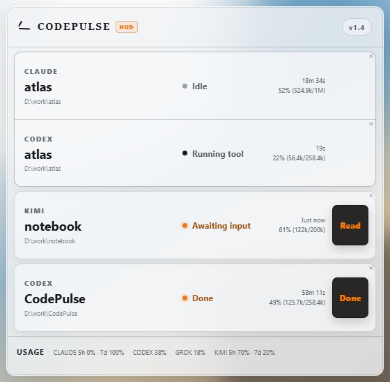

<div align="center">

# CodePulse HUD

**A local, always-visible status companion for AI coding agents.**

See whether Claude Code, Codex, Kimi Code, and Grok are working, waiting for you, finished, or blocked without repeatedly switching back to their terminals.

[](https://github.com/LBW-C137/CodePulse-HUD/releases/latest)
[](#install)
[](https://github.com/LBW-C137/CodePulse-HUD/actions/workflows/release.yml)
[](./LICENSE)

[English](./README.md) · [简体中文](./README.zh-CN.md) · [HUD design notes](./docs/HUD.md)

</div>

<p align="center">
  
</p>

CodePulse HUD is a transparent, frameless, always-on-top Windows app that stays visible without proactively stealing focus. It consumes native CLI hooks, highlights only the cards that need attention in orange, and keeps normal activity quiet.

## Highlights

- **Independent cards for every agent and project:** agents in the same workspace are grouped closely, while each card keeps its own status, timer, context, animation, and actions.
- **Stable attention semantics:** permission/input waits, unread completions, and unread failures stay orange; ordinary work remains neutral.
- **Different actions for different moments:** live waits use “Read,” while a genuinely finished turn uses “Done.”
- **Temporary per-card dismissal:** the small `×` hides only that card, exactly like retention expiry. New real activity makes it eligible to appear again.
- **Predictable retention:** idle, cancelled, and acknowledged result cards share the selected 10 / 30 / 60 / 120 / 240 minute retention setting.
- **Context and quota summary:** shows available context usage and provider quota information for Claude, Codex, Kimi, and Grok.
- **Built for a secondary display:** light, dark, and automatic themes; 20%–100% panel opacity; steady, breathe, or pulse attention effects; list and compact grid layouts.
- **Low-I/O runtime:** restores local sessions once at startup, then relies primarily on hooks instead of continuously scanning the disk.

CodePulse HUD does not include the former analytics console and no longer maintains a SQLite activity history. It focuses on one question: **which AI coding task needs my attention right now?**

## Install

Only a Windows x64 installer is currently published.

1. Quit the old CodePulse app from its tray if it is running. If you are moving to HUD permanently, uninstall the old app first.
2. Download `CodePulse-HUD_<version>_x64-setup.exe` from the [latest release](https://github.com/LBW-C137/CodePulse-HUD/releases/latest).
3. Run the installer and launch **CodePulse HUD**. The current installer is not commercially code-signed, so Windows SmartScreen may require “More info → Run anyway.”
4. First launch checks and configures supported CLI hooks. Only CodePulse-managed entries are changed; unrelated hooks and preferences are preserved.
5. Codex users must also enter `/hooks` in Codex, select the CodePulse hook, and trust the event permissions listed by the app.

The old CodePulse app and CodePulse HUD intentionally retain compatible hook identifiers and the same local port. **Do not run both applications at the same time.** Migrate in this order: quit/uninstall the old app, then install and launch HUD.

## Supported CLIs

| CLI         | Status source                                        | First-use note                                                         |
| ----------- | ---------------------------------------------------- | ---------------------------------------------------------------------- |
| Claude Code | Native hooks, status line, and local session restore | Configuration is checked when HUD starts                               |
| Codex CLI   | Native hooks and local session restore               | Trust the CodePulse hook manually in `/hooks`                          |
| Kimi Code   | Native hooks, sessions, and local quota data         | Available quota is loaded when HUD starts; no conversation is required |
| Grok        | Native hooks and local session restore               | Configuration is checked when HUD starts                               |

CLI hook events and local data formats can change between provider releases. If a state is missing, first confirm that the CLI is reasonably current, then open an issue in this repository.

## Card behavior

| State                                   | HUD presentation      | Action                                                                   |
| --------------------------------------- | --------------------- | ------------------------------------------------------------------------ |
| Thinking or running tools               | Neutral card          | No action needed                                                         |
| Waiting for permission or input         | Orange and persistent | “Read” acknowledges the alert; the runtime state still remains waiting   |
| Completed                               | Orange and persistent | “Done” acknowledges the result; normal retention then applies            |
| Error, possible stall, or usage limit   | Orange and persistent | “Read” acknowledges the alert; later runtime events continue updating it |
| Idle, cancelled, or acknowledged result | Neutral card          | Hides after the selected retention period, or immediately with `×`       |

See [HUD design notes](./docs/HUD.md) for the complete behavior contract.

## Local data and privacy

- Task state is processed locally. There is no CodePulse account, telemetry, or analytics service.
- The hook API binds only to `127.0.0.1:17888` and uses a local token stored at `~/.codepulse/local-auth`.
- The app does not store full prompts or maintain a SQLite activity history. Settings, hook runtime files, and required credentials remain on the machine.
- The app contacts GitHub to check for updates. Official provider endpoints or local credential flows may be used when reading account quotas.
- Uninstall removes CodePulse-managed hook entries while preserving unrelated hooks, models, plugins, and preferences.

## Development

Requires Node.js 20+ and pnpm 9+:

```powershell
pnpm install
pnpm dev
```

Run the local verification suite before committing:

```powershell
pnpm typecheck
pnpm test
pnpm smoke
pnpm lint
```

Build the Windows installer:

```powershell
pnpm dist:win
```

Artifacts are written to `apps/desktop/release/`. Pushing a `v*` tag makes GitHub Actions verify the repository again on Windows, build the installer, and publish a release.

## Origin

CodePulse HUD is derived from and extends [noeigenstate/CodePulse](https://github.com/noeigenstate/CodePulse), retaining its MIT license and Git history. The original project supplied the inspiration and technical base; HUD releases, Windows installers, and support in this repository are independently maintained and are not official upstream releases.

## License

[MIT](./LICENSE)
