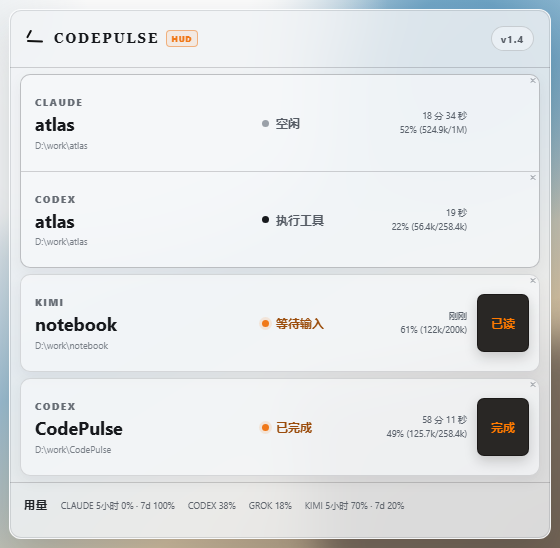

<div align="center">

# CodePulse HUD

**常驻桌面的本地 AI 编程状态副驾。**

同时使用 Claude Code、Codex、Kimi Code 或 Grok 时，不必反复切回终端确认它们是否仍在工作、等待你、已经完成或遇到问题。

[](https://github.com/LBW-C137/CodePulse-HUD/releases/latest)
[](#安装)
[](https://github.com/LBW-C137/CodePulse-HUD/actions/workflows/release.yml)
[](./LICENSE)

[English](./README.md) · [简体中文](./README.zh-CN.md) · [HUD 设计说明](./docs/HUD.md)

</div>

<p align="center">
  
</p>

CodePulse HUD 是一个透明、无边框、置顶但不主动抢焦点的 Windows 桌面应用。它通过各 CLI 的原生 hook 汇总实时状态，把真正需要你注意的卡片提升为橙色，其余活动保持安静。

## 主要功能

- **多项目与多 agent 独立显示**：同一项目中的多个 agent 紧挨归组，但每张卡片的状态、计时、上下文、动效和操作互不干扰。
- **稳定的注意语义**：等待授权/输入、未读完成和未读故障保持橙色；普通执行过程使用中性色。
- **统一的 HUD 品牌图标**：应用、安装器和托盘共用半透明白色面板与橙色脉冲；橙色是固定品牌色，只有托盘右上角的小圆点表示当前有内容需要查看。
- **“已读”与“完成”分工**：中间等待状态使用“已读”确认提醒，真正结束的任务使用“完成”。
- **临时关闭单卡**：右上角 `×` 只隐藏当前卡片，效果与停留时间到期一致；新的真实活动会让它重新出现。
- **可控停留时长**：空闲、已取消和已经确认的结果卡片统一遵守 10 / 30 / 60 / 120 / 240 分钟设置。
- **上下文与额度摘要**：显示可读取的上下文用量，以及 Claude、Codex、Kimi、Grok 可提供的账户额度。
- **适合副屏常驻**：支持浅色、深色、自动主题，20%–100% 背景透明度，常亮、呼吸或脉冲注意效果，以及单列/紧凑网格布局。
- **低 I/O 运行**：启动时恢复一次本机会话，之后主要依赖 hook 实时更新，避免持续扫描磁盘。

CodePulse HUD 不包含原项目曾提供的统计后台，也不再维护 SQLite 活动历史。它专注回答一件事：**现在有哪些 AI 编程任务需要我看一眼？**

## 安装

当前版本只发布 Windows x64 安装包。

1. 如果正在使用旧版 CodePulse，请先从托盘退出；以后只使用 HUD 时，建议先卸载旧版。
2. 在 [Releases](https://github.com/LBW-C137/CodePulse-HUD/releases/latest) 下载 `CodePulse-HUD_<版本>_x64-setup.exe`。
3. 运行安装器并启动 **CodePulse HUD**。当前安装包未进行商业代码签名，Windows SmartScreen 可能要求你选择“更多信息 → 仍要运行”。
4. 首次启动会检查并配置本机 CLI hook。应用只管理自己的 CodePulse hook，已有的其它 hook 与偏好会保留。
5. Codex 用户还需要在 Codex 中输入 `/hooks`，选择 CodePulse hook，并信任界面列出的事件权限。

旧版 CodePulse 与 CodePulse HUD 沿用同一套兼容 hook 标识和本机端口，**不要同时运行两个应用**。若要迁移，请按“退出/卸载旧版 → 安装并启动 HUD”的顺序操作。

## 支持的 CLI

| CLI         | 状态来源                               | 首次使用注意事项                            |
| ----------- | -------------------------------------- | ------------------------------------------- |
| Claude Code | 原生 hooks、status line 与本机会话恢复 | 启动 HUD 后会自动检查配置                   |
| Codex CLI   | 原生 hooks 与本机会话恢复              | 需要在 `/hooks` 中手动信任 CodePulse hook   |
| Kimi Code   | 原生 hooks、会话与本地额度信息         | 可用额度会在 HUD 启动时读取，不必先开启对话 |
| Grok        | 原生 hooks 与本机会话恢复              | 启动 HUD 后会自动检查配置                   |

CLI 自身的 hook 事件和本地数据格式可能随版本变化；若某项状态缺失，请先确认使用的是该 CLI 的近期版本，再到本仓库提交 issue。

## 卡片行为

| 状态                         | HUD 表现       | 操作                                         |
| ---------------------------- | -------------- | -------------------------------------------- |
| 思考、执行工具               | 中性卡片       | 无需处理                                     |
| 等待授权、等待输入           | 橙色并持续显示 | “已读”只确认你看到了提醒；实际状态仍保持等待 |
| 已完成                       | 橙色并持续显示 | “完成”确认本轮结果，之后按停留时长清理       |
| 出错、疑似卡住、达到用量上限 | 橙色并持续显示 | “已读”确认提醒，新的运行事件会继续更新状态   |
| 空闲、取消或已确认结果       | 中性卡片       | 到达设定时长后自动隐藏，也可点 `×` 提前隐藏  |

完整行为约定见 [HUD 设计说明](./docs/HUD.md)。

## 本地与隐私

- 任务状态在本机处理，不需要 CodePulse 账号，也没有遥测或统计服务。
- hook API 仅绑定 `127.0.0.1:17888`，并使用保存在 `~/.codepulse/local-auth` 的本机 token。
- 应用不保存提示词全文，也不建立 SQLite 活动历史；设置、hook 运行文件与必要凭据保存在本机。
- 应用会访问 GitHub 检查更新；读取账户额度时，相关 provider 的官方接口或本机凭据链路可能被使用。
- 卸载器会清理 CodePulse 管理的 hook 配置，同时保留用户自己的其它 hook、模型、插件和偏好。

## 开发

需要 Node.js 20+ 与 pnpm 9+：

```powershell
pnpm install
pnpm dev
```

提交前的本地验证：

```powershell
pnpm typecheck
pnpm test
pnpm smoke
pnpm lint
```

构建 Windows 安装包：

```powershell
pnpm dist:win
```

输出位于 `apps/desktop/release/`。推送 `v*` tag 后，GitHub Actions 会在 Windows runner 上重新验证、构建并发布安装包。

## 项目来源

CodePulse HUD 基于并扩展自 [noeigenstate/CodePulse](https://github.com/noeigenstate/CodePulse)，保留了原项目的 MIT 许可证与 Git 历史。原项目提供了灵感和技术基底；本仓库的 HUD 版本、Windows 安装包与后续支持由本仓库独立维护，并非上游官方发布。

## 许可证

[MIT](./LICENSE)
